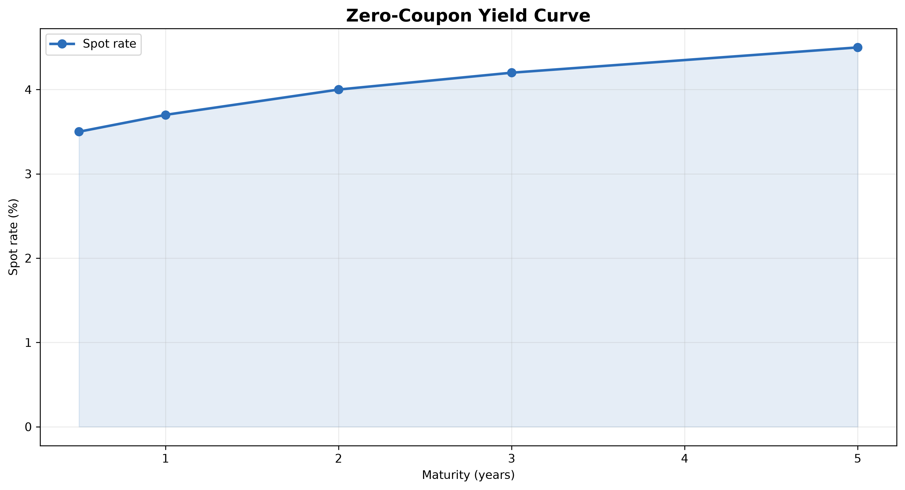
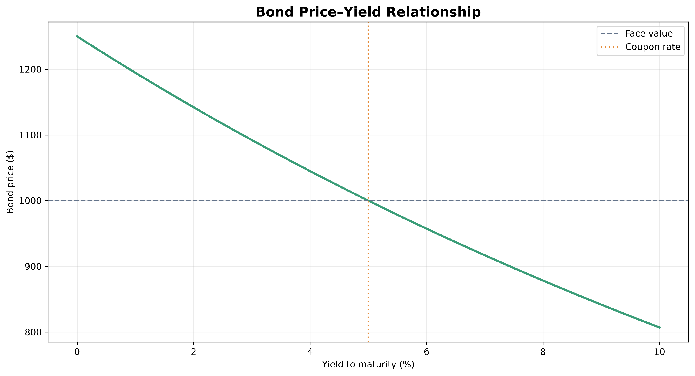
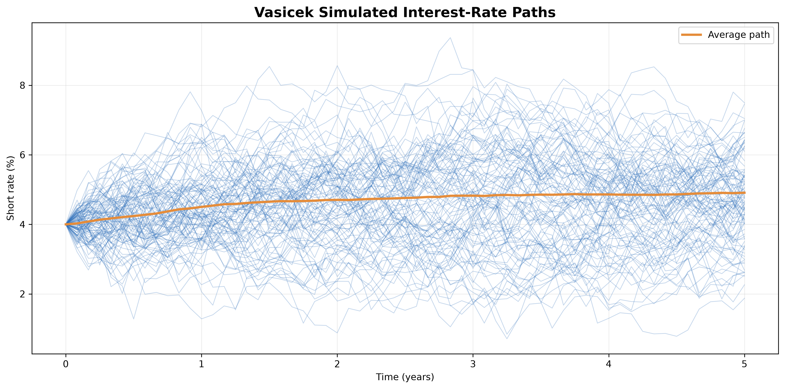
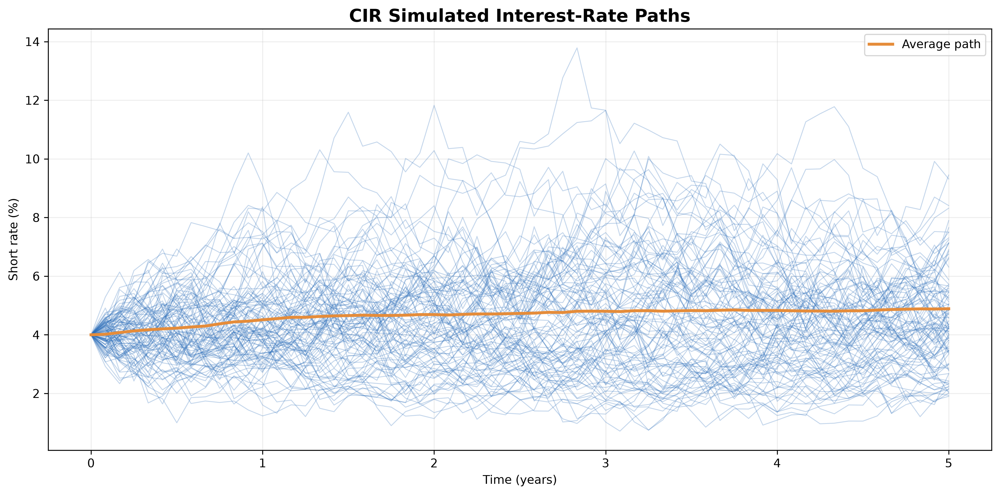
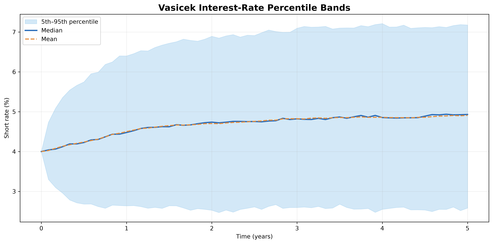
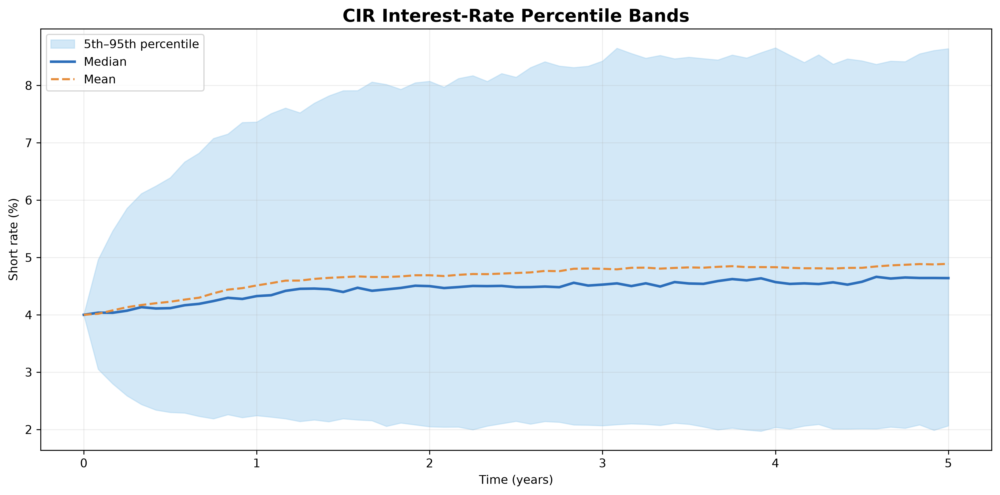
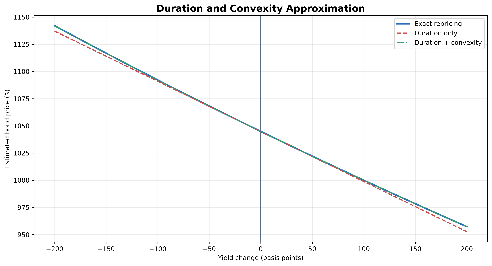

# Interest Rate & Bond Modeling Engine

[](https://www.python.org/)
[](#testing)
[](LICENSE)
[](#project-status)

A quantitative fixed-income analytics engine for bond pricing, yield analysis, duration, convexity, yield-curve construction, and stochastic interest-rate simulation using Python.

Motor cuantitativo de renta fija para valoración de bonos, análisis de rendimientos, duración, convexidad, construcción de curvas y simulación estocástica de tasas de interés con Python.

---

## English

### Overview

The Interest Rate & Bond Modeling Engine is a modular quantitative-finance project designed to analyze fixed-income instruments and interest-rate risk.

The project combines:

- Financial mathematics
- Numerical methods
- Root-finding algorithms
- Yield-curve construction
- Stochastic differential equations
- Monte Carlo simulation
- Data visualization
- Automated software testing

The engine supports the complete analytical workflow from individual bond cash flows to simulated future interest-rate scenarios.

---

## Main Features

### Bond Pricing

- Fixed-coupon bond valuation
- Zero-coupon bond valuation
- Coupon-payment calculation
- Complete cash-flow schedules
- Premium, par, and discount bond classification
- Annual, semiannual, and other payment frequencies

### Yield Analysis

- Current yield
- Yield to Maturity
- Effective annual yield
- Nominal and effective rate conversion
- Numerical YTM calculation using Brent's method
- Price reconstruction from calculated YTM

### Interest-Rate Risk

- Macaulay duration
- Modified duration
- Convexity
- DV01
- Duration-only price approximation
- Duration-and-convexity price approximation
- Exact bond repricing after yield movements

### Yield-Curve Analytics

- Discount factors
- Zero-coupon spot rates
- Implied forward rates
- Linear spot-rate interpolation
- Zero-coupon yield-curve construction
- Sequential bootstrapping from coupon-bond prices

### Stochastic Rate Models

- Vasicek model
- Cox-Ingersoll-Ross model
- Mean reversion
- Brownian-motion shocks
- Full-truncation Euler method for CIR
- Feller-condition verification
- Reproducible Monte Carlo simulations
- Terminal-rate statistics
- Percentile bands

### Visualizations

- Zero-coupon yield curve
- Bond price-yield relationship
- Vasicek simulated paths
- CIR simulated paths
- Vasicek percentile bands
- CIR percentile bands
- Duration and convexity approximation

---

## Mathematical Models

| Model or measure | Purpose |
|---|---|
| Present-value pricing | Calculates the theoretical value of bond cash flows |
| Current yield | Measures annual coupon income relative to price |
| Yield to Maturity | Calculates the return implied by market price |
| Macaulay duration | Measures the weighted average cash-flow timing |
| Modified duration | Estimates first-order price sensitivity |
| Convexity | Measures curvature in the price-yield relationship |
| DV01 | Estimates monetary sensitivity to one basis point |
| Spot rates | Discount individual cash flows by maturity |
| Forward rates | Derive implied future rates from the spot curve |
| Bootstrapping | Recover zero rates from coupon-bearing instruments |
| Vasicek | Simulate Gaussian mean-reverting interest rates |
| CIR | Simulate non-negative mean-reverting interest rates |

Detailed formulas and implementation assumptions are available in [`docs/methodology.md`](docs/methodology.md).

---

## Example Bond

The baseline analysis uses:

| Parameter | Value |
|---|---:|
| Face value | $1,000 |
| Annual coupon rate | 5.00% |
| Maturity | 5 years |
| Payments per year | 2 |
| Market yield | 4.00% |

Example results:

| Measure | Result |
|---|---:|
| Periodic coupon | $25.00 |
| Number of payments | 10 |
| Fixed-coupon bond price | $1,044.91 |
| Zero-coupon bond price | $820.35 |
| YTM at a $950 market price | Approximately 6.19% |

The coupon bond trades at a premium when its coupon rate exceeds the market yield.

---

## Project Structure

```text
interest-rate-bond-modeling-engine/
│
├── docs/
│   └── methodology.md
│
├── notebooks/
│   └── fixed_income_analysis.ipynb
│
├── results/
│   └── figures/
│       ├── cir_paths.png
│       ├── cir_percentile_bands.png
│       ├── duration_convexity.png
│       ├── price_yield_relationship.png
│       ├── vasicek_paths.png
│       ├── vasicek_percentile_bands.png
│       └── yield_curve.png
│
├── src/
│   ├── __init__.py
│   ├── bond_pricing.py
│   ├── duration_convexity.py
│   ├── rate_models.py
│   ├── visualization.py
│   ├── yield_curve.py
│   └── yield_metrics.py
│
├── tests/
│   ├── test_bond_pricing.py
│   ├── test_duration_convexity.py
│   ├── test_rate_models.py
│   ├── test_visualization.py
│   ├── test_yield_curve.py
│   └── test_yield_metrics.py
│
├── .gitignore
├── LICENSE
├── README.md
└── requirements.txt
```

---

## Installation

### 1. Clone the repository

```powershell
git clone https://github.com/acarrillofintech/interest-rate-bond-modeling-engine.git
cd interest-rate-bond-modeling-engine
```

### 2. Create a virtual environment

```powershell
py -m venv .venv
```

### 3. Activate the environment

```powershell
Set-ExecutionPolicy -Scope Process -ExecutionPolicy RemoteSigned
.\.venv\Scripts\Activate.ps1
```

### 4. Install dependencies

```powershell
python -m pip install --upgrade pip
python -m pip install -r requirements.txt
python -m pip check
```

---

## Usage

Run the bond-pricing example:

```powershell
python -m src.bond_pricing
```

Run the yield analysis:

```powershell
python -m src.yield_metrics
```

Run duration, convexity, and DV01:

```powershell
python -m src.duration_convexity
```

Run the yield-curve analysis:

```powershell
python -m src.yield_curve
```

Run Vasicek and CIR simulations:

```powershell
python -m src.rate_models
```

Generate all figures:

```powershell
python -m src.visualization
```

---

## Notebook

The complete interactive analysis is available at:

```text
notebooks/fixed_income_analysis.ipynb
```

The notebook includes:

1. Fixed-coupon and zero-coupon bond pricing
2. Cash-flow tables
3. Current yield and YTM
4. Duration, convexity, and DV01
5. Price-yield visualization
6. Spot and forward rates
7. Yield-curve construction
8. Bootstrapping
9. Vasicek simulation
10. CIR simulation
11. Percentile bands
12. Financial interpretation and conclusions

Start Jupyter with:

```powershell
python -m jupyter notebook
```

Alternatively, open the notebook directly in Visual Studio Code.

---

## Testing

The project contains **197 automated tests** covering:

- Bond prices
- Cash-flow schedules
- Yield calculations
- Rate conversions
- Numerical derivatives
- Duration and convexity
- DV01
- Discount factors
- Spot and forward rates
- Interpolation
- Bootstrapping
- Vasicek simulations
- CIR simulations
- Feller condition
- Reproducibility
- Input validation
- Figure generation

Run all tests:

```powershell
python -m pytest -q
```

Expected result:

```text
197 passed
```

Run detailed tests:

```powershell
python -m pytest -v
```

---

## Figures

### Zero-Coupon Yield Curve



### Bond Price-Yield Relationship



### Vasicek Simulated Paths



### CIR Simulated Paths



### Vasicek Percentile Bands



### CIR Percentile Bands



### Duration and Convexity



---

## Technology Stack

- Python 3.14
- NumPy
- Pandas
- SciPy
- Matplotlib
- Seaborn
- Jupyter
- pytest

---

## Assumptions and Limitations

The engine assumes:

- Deterministic contractual cash flows
- No issuer default
- No embedded options
- No taxes or transaction costs
- No accrued-interest adjustment
- Regular coupon periods
- Constant model parameters
- Parallel yield changes for duration analysis

The stochastic models use illustrative parameters and are not calibrated to live market data.

The project is an educational and quantitative-research engine rather than a production trading platform.

---

## Project Status

Current version: **1.0.0**

Completed components:

- [x] Bond pricing
- [x] Yield calculations
- [x] Duration and convexity
- [x] DV01
- [x] Yield curves
- [x] Forward rates
- [x] Bootstrapping
- [x] Vasicek model
- [x] CIR model
- [x] Visualizations
- [x] Automated tests
- [x] Mathematical methodology
- [x] Interactive notebook

---

# Español

## Descripción

Interest Rate & Bond Modeling Engine es un motor cuantitativo modular para analizar instrumentos de renta fija y riesgo de tasas de interés.

El proyecto integra:

- Matemática financiera
- Métodos numéricos
- Algoritmos de búsqueda de raíces
- Construcción de curvas
- Ecuaciones diferenciales estocásticas
- Simulación Monte Carlo
- Visualización de datos
- Pruebas automatizadas

El motor cubre el flujo completo desde los pagos individuales de un bono hasta la simulación de posibles escenarios futuros para las tasas de interés.

---

## Funcionalidades principales

### Valoración de bonos

- Bonos con cupón fijo
- Bonos cupón cero
- Cálculo del cupón periódico
- Calendarios de flujos de efectivo
- Bonos con prima, a la par y con descuento
- Frecuencias anuales, semestrales y otras

### Análisis de rendimientos

- Rendimiento corriente
- Rendimiento al vencimiento
- Rendimiento efectivo anual
- Conversión de tasas nominales y efectivas
- Cálculo numérico del YTM mediante el método de Brent
- Reconstrucción del precio a partir del YTM

### Riesgo de tasas de interés

- Duración de Macaulay
- Duración modificada
- Convexidad
- DV01
- Aproximación mediante duración
- Aproximación mediante duración y convexidad
- Revaloración exacta después de cambios en tasas

### Curvas de rendimiento

- Factores de descuento
- Tasas spot
- Tasas forward implícitas
- Interpolación lineal
- Construcción de curvas cupón cero
- Bootstrapping desde precios de bonos

### Modelos estocásticos

- Modelo Vasicek
- Modelo Cox-Ingersoll-Ross
- Reversión a la media
- Choques brownianos
- Método Euler con truncamiento completo para CIR
- Condición de Feller
- Simulaciones reproducibles
- Estadísticas de tasas terminales
- Bandas percentiles

---

## Ejecución

Valoración de bonos:

```powershell
python -m src.bond_pricing
```

Análisis de rendimiento:

```powershell
python -m src.yield_metrics
```

Duración, convexidad y DV01:

```powershell
python -m src.duration_convexity
```

Curva de rendimientos:

```powershell
python -m src.yield_curve
```

Simulaciones Vasicek y CIR:

```powershell
python -m src.rate_models
```

Generación de gráficos:

```powershell
python -m src.visualization
```

Pruebas completas:

```powershell
python -m pytest -q
```

Resultado esperado:

```text
197 passed
```

---

## Documentación

La metodología matemática detallada está disponible en:

[`docs/methodology.md`](docs/methodology.md)

El análisis interactivo completo está disponible en:

[`notebooks/fixed_income_analysis.ipynb`](notebooks/fixed_income_analysis.ipynb)

---

## Calidad del software

El proyecto fue construido utilizando:

- Arquitectura modular
- Clases de datos inmutables
- Validación de parámetros
- Anotaciones de tipos
- Semillas aleatorias reproducibles
- Separación entre modelos y visualización
- Pruebas unitarias
- Documentación matemática
- Control de versiones con Git

Las **197 pruebas automatizadas** validan tanto los resultados financieros como el comportamiento del software.

---

## Limitaciones

El motor no incluye actualmente:

- Riesgo de crédito
- Bonos con opciones
- Convenciones de conteo de días
- Interés acumulado
- Costos de transacción
- Impuestos
- Calibración con datos en tiempo real
- Duraciones por vértice
- Modelos multifactoriales
- Calibración Hull-White

Estas extensiones pueden incorporarse en versiones futuras.

---

## Autor

**Alexander Carrillo Reyes**

- Systems Engineer
- MSc in Financial Mathematics
- Quantitative Finance and Risk Technology Portfolio
- GitHub: [acarrillofintech](https://github.com/acarrillofintech)

---

## License

This project is licensed under the MIT License. See [`LICENSE`](LICENSE) for details.

Este proyecto se distribuye bajo la licencia MIT. Consulte [`LICENSE`](LICENSE) para obtener más información.

---

## Disclaimer

This software is intended exclusively for educational, quantitative-research, and software-development purposes.

It does not constitute investment advice, financial advice, trading advice, or a guarantee of future performance.

Este software está destinado exclusivamente a fines educativos, de investigación cuantitativa y demostración de desarrollo de software.

No constituye asesoría financiera, recomendación de inversión ni garantía de resultados futuros.